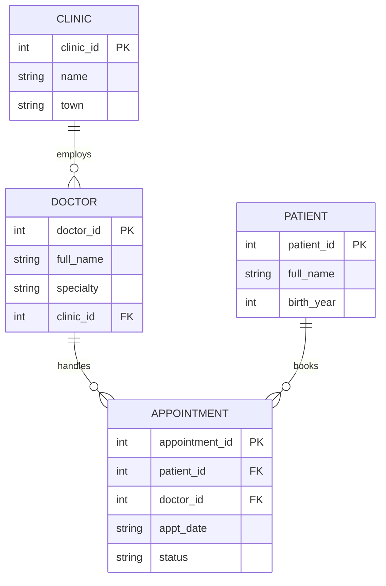

# Clinic Appointments Database

A small relational database for a fictional group of clinics, designed from an ERD and queried with SQL to answer business questions.

## ERD


## Questions answered (`queries.sql`)
1. Appointments per clinic
2. No-show rate per clinic
3. Patients who have missed an appointment
4. Busiest doctor by attended appointments

## Run it
```bash
sqlite3 clinic.db < schema.sql
sqlite3 -header -column clinic.db < queries.sql
```

## Skills shown
Data modelling (ERD), normalisation, primary/foreign keys, constraints, joins, aggregation.

*All data is fictional.*
