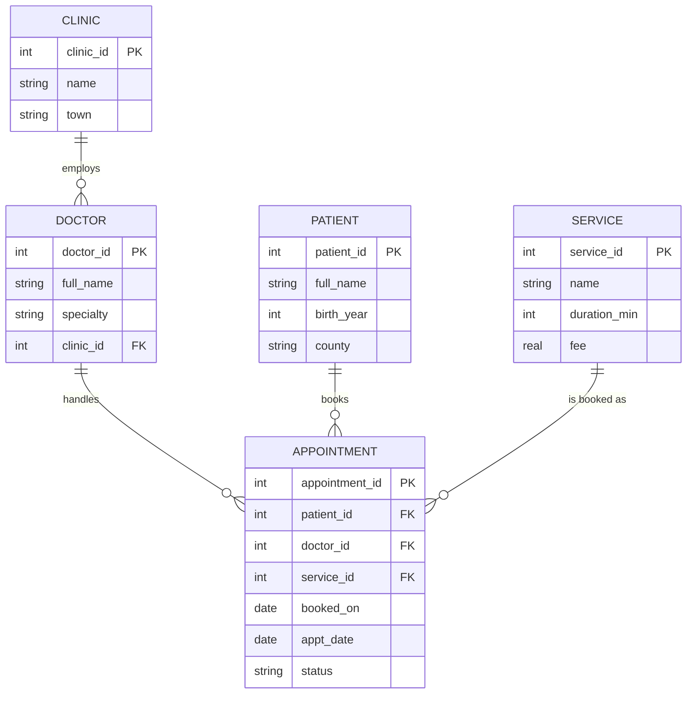

# Clinic Appointments Database & Analysis

A relational database for a fictional group of three clinics: designed from an ERD, normalised to 3NF, built in SQLite, and used to answer business questions with SQL. A Python script runs the analysis and exports each result to CSV for Excel or Power BI.

## ERD


## Design decisions
- **Fees are stored on `service`, not on `appointment`.** A price change happens in one place, which avoids update anomalies. (A real system would also keep price history.)
- **Constraints protect data quality.** `CHECK` constraints limit `status` to valid values, stop an appointment being dated before it was booked, and keep fees non-negative.
- **Indexes** on the foreign-key and date columns used in joins and filters.
- **A reporting view** (`v_appointment_details`) joins everything once, works out lead time and revenue, and gives Power BI a single flat table to connect to.

## Business questions (`sql/04_analysis.sql`)
| Question | SQL techniques |
|---|---|
| How do clinics compare on volume, no-shows and revenue? | Aggregation, conditional sums |
| How is revenue trending month to month? | CTE, `LAG()` window function |
| Are bookings made far in advance missed more often? | `CASE` bucketing |
| Who earns the most within each clinic? | `RANK() OVER (PARTITION BY …)` |
| What share of revenue comes from each service? | Subquery for the total |
| Which patients repeatedly miss appointments? | CTE, `HAVING` |

## Sample findings
Results are exported to [`reports/`](reports). On the sample data:

| Booked ahead | Appointments | No-show rate |
|---|---|---|
| 0–2 days | 76 | 2.6% |
| 3–7 days | 69 | 5.8% |
| 8–14 days | 47 | 19.1% |
| 15+ days | 48 | 31.3% |

The no-show rate climbs steeply for appointments booked more than a week ahead. Galway Central has the highest no-show rate (17.4%). One recommendation would be an SMS reminder 48 hours before appointments booked more than seven days in advance, starting with the patients flagged in `repeat_no_show_patients.csv`.

> **Note:** the data is generated by `scripts/generate_seed.py`, which deliberately builds in a link between lead time and no-shows. The point of the project is to show that the queries detect it, not to make a real-world claim.

## Project structure
```
sql/
  01_schema.sql         tables, constraints, indexes
  02_seed_data.sql      generated sample data (3 clinics, 6 doctors, 40 patients, 240 appointments)
  03_views.sql          reporting view
  04_analysis.sql       business questions
scripts/
  generate_seed.py      creates reproducible fictional data
  run_reports.py        builds the DB, runs every query, exports CSVs
reports/                query results as CSV
```

## How to run
```bash
python scripts/run_reports.py       # builds clinic.db and writes reports/*.csv
```
Or run the SQL files in order with `sqlite3 clinic.db`.

## What I'd add next
- A Power BI dashboard connected to `v_appointment_details`
- Price history (a `service_price` table with valid-from and valid-to dates)
- Opening hours and doctor schedules, to measure capacity use
